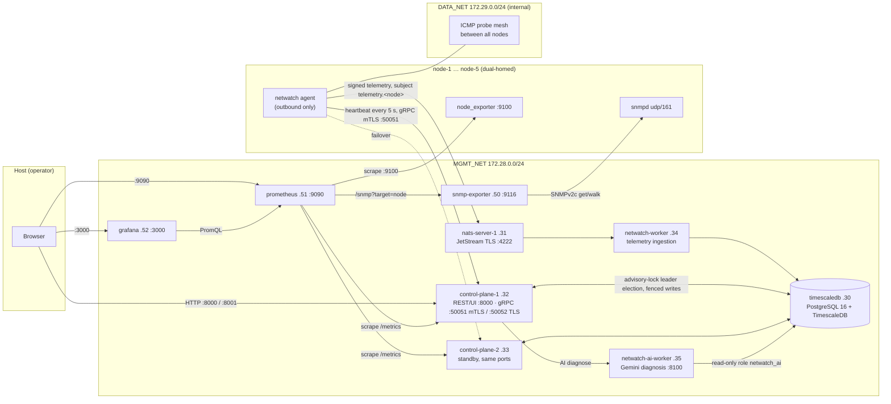

# NetWatch architecture, addressing plan and indicators (planning S1)

This document covers the monitoring architecture, the lab's addressing plan and the indicators
NetWatch measures. Everything below matches `docker-compose.yml` and the code. If an address or a
threshold changes there, update this page.

## 1. Architecture

Two isolated networks:
- **MGMT_NET** carries all monitoring traffic: control, telemetry and scraping.
- **DATA_NET** is the monitored network. It is `internal`, with no route to the host or the internet.

Nodes never accept NetWatch connections. The agent dials out to the control planes and to NATS.
The only listening services on a node are the classic-monitoring baselines (snmpd, node_exporter),
and they answer on MGMT_NET only.

### Data flows

| Flow | From → to | Transport | Period |
| --- | --- | --- | --- |
| Heartbeat, probe commands, peer list | agent → leader control plane | gRPC over mTLS (per-node client certificate), `:50051` | 5 s |
| Enrollment (certificate signing) | agent → control plane | gRPC over TLS + join token, `:50052` | once per 24 h certificate |
| Host and interface telemetry | agent → NATS `TELEMETRY` stream → worker → TimescaleDB | NATS over TLS, signed messages, deduplicated by `boot_id` + `seq_id` | 1 s |
| Active probes (loss, latency) | node → every peer over DATA_NET | ICMP | 5 s |
| Path traces | node → peer over DATA_NET (on demand) | traceroute (UDP) | on request |
| SNMP baseline (T0) | prometheus → snmp-exporter → snmpd | SNMPv2c, read-only community, MGMT_NET only | 15 s |
| Host metrics | prometheus → node_exporter | HTTP `:9100`, MGMT_NET only | 15 s |
| NetWatch state (T1) | prometheus → control planes `/metrics` | HTTP `:8000` | 15 s |
| Dashboards | grafana → prometheus | PromQL over HTTP | 15 s refresh |

### High availability

- Two control-plane replicas share the database. The leader holds a PostgreSQL advisory lock and a
  `leader_epoch`, and every write is fenced on that epoch.
- When the leader dies, the standby takes over in under 5 s. The standby forwards REST writes to
  the leader (`PEER_REST_URL`), so the console works on either port.
- Agents keep up to 1,000 telemetry ticks in memory while NATS is unreachable, then replay them.

## 2. Addressing plan

### Networks

| Network | Docker name | Subnet | Gateway | Role |
| --- | --- | --- | --- | --- |
| MGMT_NET | `mgmt_net` | `172.28.0.0/24` | `172.28.0.1` (Docker bridge) | Management, telemetry, scraping, operator access through published ports |
| DATA_NET | `data_net` | `172.29.0.0/24` | none (`internal: true`) | Monitored data plane, only node-to-node traffic |

### Hosts

| Range | Host | MGMT_NET | DATA_NET | Ports (on MGMT_NET) | Published on the host |
| --- | --- | --- | --- | --- | --- |
| `.30–.39` platform | timescaledb | 172.28.0.30 | – | 5432/tcp | `localhost:5432` |
|  | nats-server-1 | 172.28.0.31 | – | 4222/tcp (TLS), 8222/tcp (monitoring) | `4222`, `8222` |
|  | control-plane-1 | 172.28.0.32 | – | 8000/tcp REST+UI, 50051/tcp gRPC mTLS, 50052/tcp gRPC TLS | `localhost:8000` |
|  | control-plane-2 | 172.28.0.33 | – | same | `localhost:8001` |
|  | netwatch-worker | 172.28.0.34 | – | none (client only) | – |
|  | netwatch-ai-worker | 172.28.0.35 | – | 8100/tcp (token-protected) | – |
| `.40–.49` monitored nodes | node-1 | 172.28.0.40 | 172.29.0.10 | 161/udp snmpd, 9100/tcp node_exporter | – |
|  | node-2 | 172.28.0.41 | 172.29.0.11 | same | – |
|  | node-3 | 172.28.0.42 | 172.29.0.12 | same | – |
|  | node-4 | 172.28.0.43 | 172.29.0.13 | same | – |
|  | node-5 | 172.28.0.44 | 172.29.0.14 | same | – |
| `.50–.59` monitoring | snmp-exporter | 172.28.0.50 | – | 9116/tcp | – |
|  | prometheus | 172.28.0.51 | – | 9090/tcp | `localhost:9090` |
|  | grafana | 172.28.0.52 | – | 3000/tcp | `localhost:3000` |

All addresses are static, set in `docker-compose.yml`. The one-shot `cert-init` container has no
fixed address. Inside a node, Docker decides which network becomes `eth0` and which `eth1`, so the
agent finds its data interface by its `172.29.0.x` address, never by name.

## 3. Indicators

Each indicator is listed with its source and where to read it. T0 is what classic SNMP polling
sees; T1 is what NetWatch adds.

### Availability

| Indicator | Source | Threshold / rule | Where to see it |
| --- | --- | --- | --- |
| Node health (`healthy` / `degraded` / `offline`) | heartbeat age, `LeaseManager` | degraded after 7.5 s without a heartbeat, offline after 12 s; one `Node unreachable` alert per offline node | console map, `netwatch_node_status`, `netwatch_node_up`, Grafana T1 *Node health* |
| Heartbeat age | `nodes.last_heartbeat` | expected under 5 s | `netwatch_node_heartbeat_age_seconds` |
| Link up / down | observed links from the probe mesh | a declared link not observed = *missing* drift | console map, `netwatch_link_up`, `netwatch_link_status` |
| Topology drift | desired vs. observed topology | missing declared link, undeclared observed link, lossy link | console *Fixes*, *Diagnose drift* |
| Control-plane leadership | advisory lock | exactly one leader | `netwatch_control_plane_leader` (sum must be 1), Grafana T1 *Leader* |
| SNMP agent reachable (T0) | snmp-exporter | target up | `up{job="snmp"}`, Grafana T0 |
| Interface operational state (T0) | IF-MIB `ifOperStatus` | 1 = up | Grafana T0 *Interface oper status* |
| Agent uptime (T0) | `sysUpTime` | reset = reboot | Grafana T0 *Agent uptime* |

### Performance

| Indicator | Source | Threshold / rule | Where to see it |
| --- | --- | --- | --- |
| Packet loss per directed link | ICMP probes, 30 s average | alert above 2 % (`critical` from 20 %), resolved at or below 1 %; must persist 15 s | `netwatch_link_packet_loss_percent`, console link hover, Grafana T1 |
| Latency per directed link | ICMP probes, 30 s average | alert above the link's declared `expected_latency_ms` (20 ms if undeclared); resolved at or below 80 % of it | `netwatch_link_latency_ms`, Grafana T1 |
| Path (hops) between two nodes | traceroute on demand | timeouts and unexpected hops | console *Trace* |
| Open alerts by severity | `alerts` table | – | `netwatch_alerts_open`, console *Alerts* |

### Saturation and errors

| Indicator | Source | Where to see it |
| --- | --- | --- |
| Interface throughput in / out | agent `/sys` counters (1 s); SNMP `ifHCIn/OutOctets` (T0); node_exporter `node_network_*_bytes_total` | console node charts, Grafana T0 and T1 |
| Interface errors and drops | agent counters; SNMP `ifIn/OutErrors`, `ifIn/OutDiscards` (T0) | Grafana T0 *Interface errors and discards* |
| CPU usage | agent `/proc/stat`; node_exporter `node_cpu_seconds_total` | console node charts, Grafana T1 |
| Memory usage | agent `/proc/meminfo`; node_exporter `node_memory_*` | console node charts, Grafana T1 |
| Load average | node_exporter `node_load1/5/15` | Prometheus |

In Docker, all nodes share the host's kernel, so CPU, memory and load are the host's numbers and
are identical on every node. Interface counters are per node.

### Why both T0 and T1

SNMP polls each node's own counters over the management network. It cannot see what happens
*between* nodes on the data path. Measured in `docs/BENCHMARK.md`:
- with 30 % loss on node-3's DATA_NET, SNMP saw nothing and its error counters stayed at 0;
- NetWatch marked the links degraded in about 4–8 s and raised an alert in about 20–25 s;
- NetWatch detected a frozen node in 10.9 s; the first failed SNMP poll came at 45.9 s.
